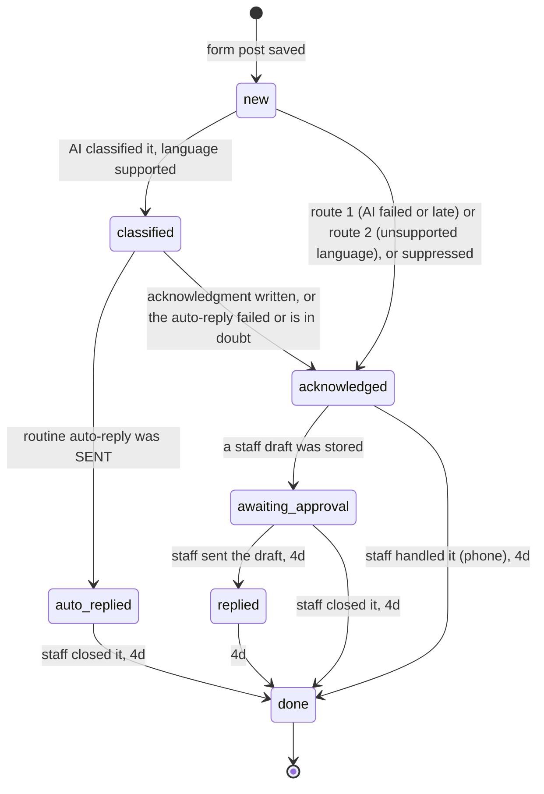
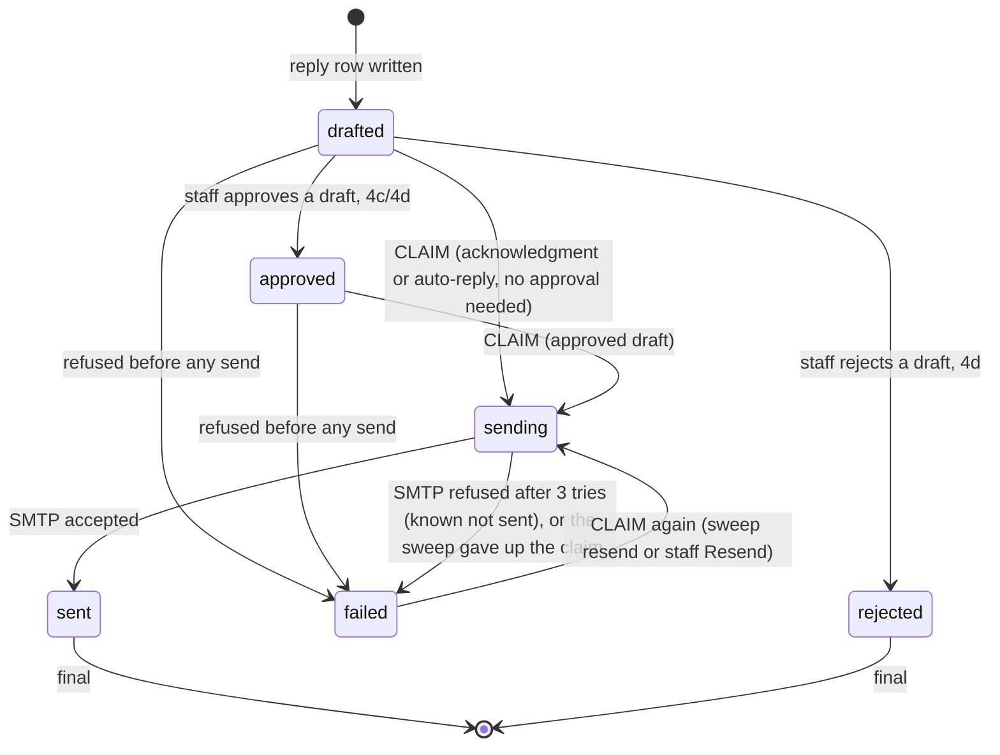
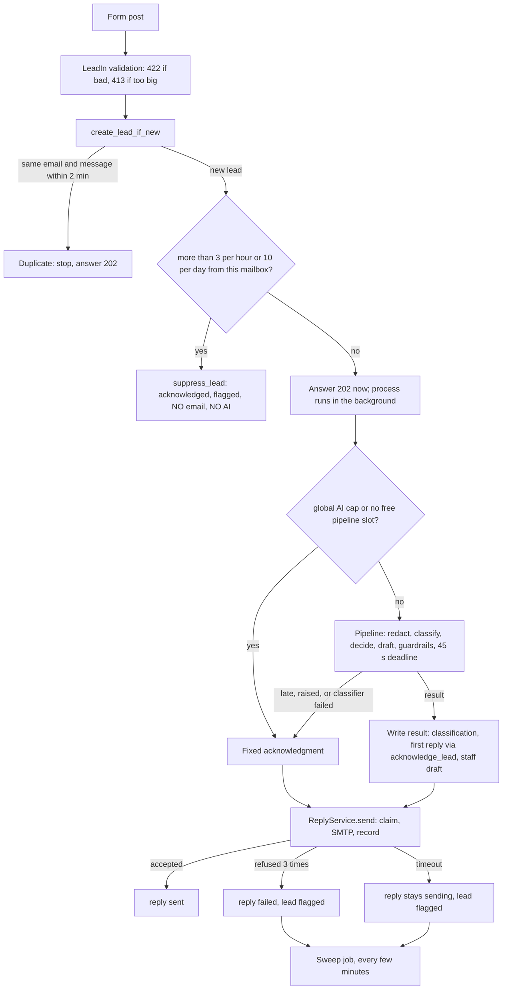
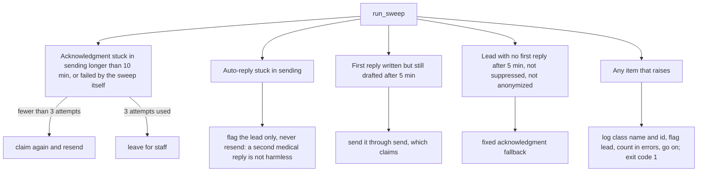

# A1 status flows (leads and replies)

> Part of the A1 review set; index in [../REVIEW.md](../REVIEW.md). Diagrams are Mermaid: they render on GitHub and in the VS Code preview with a Mermaid extension. The truth is in code: `LEAD_TRANSITIONS` and `REPLY_TRANSITIONS` in `lead_responder/db/models.py`; if they change, change this file in the same commit. Last checked against the code: 2026-10-25 (layer 4b).

Two things have a status: the **lead** (the person who wrote) and each **reply** (an email we drafted or sent). One lead has one to three replies, so read the diagrams as two machines that run side by side.

## 1. Lead status

Who moves the lead:
| Move | Done by | Code |
|---|---|---|
| `new -> classified` | `IntakeService._write_result` | `intake.py` |
| `new/classified -> acknowledged` | `Repository.acknowledge_lead` (when the first reply is an acknowledgment) or `suppress_lead` | `repository.py` |
| `classified -> auto_replied` | `ReplyService._update_lead`, only after the auto-reply is really `sent` | `replies.py` |
| `classified -> acknowledged` after a failed auto-reply | `ReplyService._update_lead` (also flags the lead) | `replies.py` |
| `acknowledged -> awaiting_approval` | `IntakeService._write_result` after storing the draft | `intake.py` |
| anything to `done`, `awaiting_approval -> replied` | staff actions in 4d (not built) | none yet |

## 2. Reply status

`sending` also has a third exit that is not a table move: **a timeout leaves the reply in `sending`** (outcome unknown). Only the sweep (acknowledgments) or staff (everything else) decide what happens next.

## 3. One lead, both machines: what you will see per scenario

| Scenario | Lead: new → ... | Replies (kind: status) | Email goes out |
|---|---|---|---|
| **Routine**, auto-reply allowed | `new -> classified -> auto_replied` | `auto_reply: drafted -> sending -> sent` | the AI-written auto-reply |
| **Routine** but no auto-reply (`AUTO_REPLY_MODE=outside_hours` and the practice is open, route 4; or the guardrails downgraded the auto-reply), or a **sensitive** message (route 3) | `new -> classified -> acknowledged -> awaiting_approval` | `acknowledgment: drafted -> sending -> sent`, `draft: drafted` (waits for staff) | the fixed acknowledgment now; the draft only after staff approve (4d) |
| **Route 1**: AI down, late (45 s) or raised | `new -> acknowledged`, flagged `needs_manual_review` | `acknowledgment: drafted -> sending -> sent`; no draft | fixed DE+EN acknowledgment (fallback) |
| **Route 2**: language not DE/EN | `new -> acknowledged`, flagged | `acknowledgment` as above; no draft | combined DE+EN acknowledgment |
| **Suppressed**: 4th post from one address in an hour | `new -> acknowledged`, flagged, `send_suppressed` | none | nothing, on purpose |
| **Duplicate** (same email + message within 2 minutes) | no new lead | none | nothing |
| **Auto-reply fails** (SMTP refuses) | `classified -> acknowledged`, flagged | `auto_reply: ... -> failed` | nothing; staff see it |
| **Send times out** (any kind) | lead flagged; an auto-reply moves it to `acknowledged` | `... -> sending` and stays | maybe; unknown |

## 4. The whole path of one post

## 5. What the sweep does (the safety net, `ReplyService.sweep`)

Staff drafts are never sent by the sweep.

## 6. Not built yet (4c, 4d)

Approve, edit, reject and resend actions, "mark delivered" or "not delivered" for a stuck `sending` reply, `awaiting_approval -> replied`, and every move to `done`. They will use the same two tables: no new status is planned.
